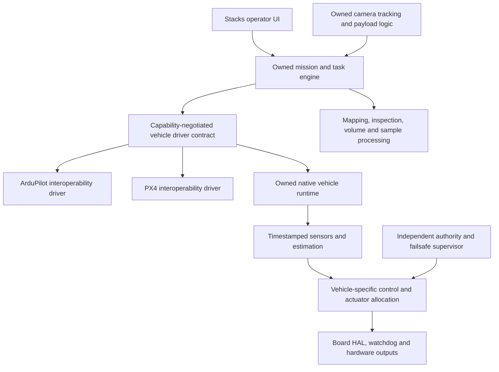

# ADR 1: Own the autonomy stack behind replaceable drivers

Status: accepted direction from the owner, October 17, 2026.

## Decision

Build our own vehicle runtime, estimation, controls, mission execution, payload workflows and Stacks
operator interface. ArduPilot and PX4 remain optional interoperability drivers during development
and for users who choose them. Neither defines the domain API for new mission or survey code.
No upstream firmware source is vendored into the MIT application by this change.

The current TypeScript code is a simulator and companion application. It is not board firmware.
A Linux/Bun camera process is not the motor timing authority. A native implementation starts with
one board, one vehicle and deterministic bench/physics/HIL evidence, then expands in validated slices.
The board runtime language/toolchain must be selected explicitly from measured hardware constraints;
there is no claim that TypeScript on a Pi meets a real-time flight-control deadline.

## Module ownership

- Common mission contracts own goals, task state, geospatial frames, permissions and evidence.
- Drivers own firmware-specific mode translation, protocol capabilities, acknowledgements, timing and loss semantics.
- Estimation owns calibration, time alignment, pose/covariance, origin and health.
- Vehicle controllers own dynamics, allocation and achievable motion limits. Air, ground, surface,
  underwater and antenna mechanisms do not share one unqualified velocity API.
- The safety supervisor owns arming, pilot authority, watchdogs, kill/neutral output and recovery.
- Payloads own sensor/actuator calibration, exposure/sample timing and acknowledgement.
- Processing owns photogrammetry/point-cloud products, CRS/datums, quality, volume and uncertainty.
- Operations own logging/replay, configuration provenance, diagnostics, updates and access/retention.

Keep application logic in `resources/functions/drone/`, grouped by the domain that owns it, and
reusable UI in `resources/components/`. Add native Stacks models/migrations when persistent mission,
aircraft or survey records are implemented; transient tracking remains process-local.

## Replacement strategy

1. Stabilize the shared contract and cross-driver conformance tests using existing simulator adapters.
2. Implement the owned board sensor-to-neutral-output loop with deadlines and watchdog evidence.
3. Add estimation and vehicle control in physics simulation, then disabled-prop HIL.
4. Establish authority/failsafes before enabling any physical native output.
5. Execute one owned waypoint mission and payload trigger, then domain workflows.
6. Implement each currently external firmware feature behind the same capability contract. Switch a
   feature only after equivalent behavior/failure tests pass; keep an explicit unsupported status otherwise.

## Evidence and coverage

The roadmap accounts for every directory in a pinned top-level upstream inventory. That accounting
is not all-feature parity. The parity issue expands modules into modes, parameters, messages, hardware
variants and failure cases, and a coverage check catches dangling/unassigned roadmap entries.
Surface/subsea use cases, photogrammetric reconstruction, survey uncertainty and BVLOS operations
include work beyond a general autopilot, so they have their own acceptance criteria and validation.
