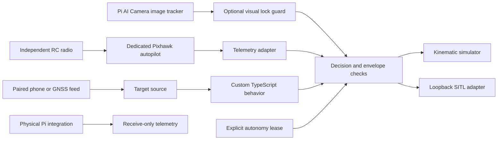

# Architecture and failure behavior

The Pi runs Bun and Stacks for mission/camera logic. The owned runtime, estimation,
controls and mission paths are described below; their physical board profile remains
neutral-only. ArduCopter and PX4 are optional dedicated-controller drivers for
development, with independent stabilization, motor timing, fencing, battery handling
and RC override. Physical integration is receive-only. Linux plus JavaScript is not
used as a real-time motor-control loop.

The coordinate frame is local north/east/down in metres. The horizontal origin is fixed; altitude
is positive up in user settings and negative down in vectors. The UDP adapter reads local EKF
coordinates, so the target source must use that same EKF origin, not a guessed current GPS position
or an origin that moves with the operator. Home position and EKF origin can differ. Resolve that
reference explicitly in any future physical adapter. GPS altitude from a phone is not copied into
flight altitude; follow altitude is configured above the fixed origin.

## Decisions

| Decision | Simulation | SITL wire behavior |
| --- | --- | --- |
| `velocity` | Apply bounded ideal velocity | Send velocity-only LOCAL_NED setpoint |
| `hold` | Zero ideal velocity | Send zero-velocity setpoints while target validity is lost |
| `release` | Zero ideal velocity | Stop sending; autopilot Guided timeout / failsafes own the response |

`release` does not prove that an aircraft immediately stops, returns home, lands, or becomes manually
controlled. Existing setpoints can persist until the autopilot times them out. Configure and test
that timeout independently. Power loss, Pi failure and SIGKILL cannot deliver a final command.

Checks reject stale/future/non-finite data, unknown batteries, absent position estimates, disarmed or
non-Guided mode, unselected targets, weak/old/inaccurate target fixes, current and predicted envelope
breaches, invalid plugin output, and predicted static-target separation breaches.

These checks provide a software development envelope, not a flight safety certification. They assume
an instantaneous ideal velocity response. Airframe braking, GPS uncertainty, wind, dynamics, terrain,
people and obstacles need separate analysis and independent flight-controller limits.

## Clocks and ownership

All freshness times are local monotonic receipt times from one clock domain. Do not use phone
wall-clock timestamps or vehicle boot times as `receivedAtMs`. Local receipt timestamps do not reveal
a delayed upstream fix: the authenticated source must also reject old/replayed measurements before
calling `update`. Validate freshness at every transport hop.

The controller clones target updates, ignores updates for other target IDs, rejects older updates,
and revokes its lease on backwards local time. Leases are at most five seconds and default to one.
A caller must tick promptly and renew only while the operator's control conditions remain valid.
A blocking plugin can starve that loop, so independent autopilot timeout remains essential.

## Protocol boundary

The codec accepts a CRC-checked common.xml subset for telemetry, velocity and the new command/parameter/mission protocols in MAVLink v1/v2. It supports v2 zero-tail
reconstruction. Unknown dialects are skipped. Signed v2 requires the optional strict signature verifier; unsigned input is refused when signing is configured.
The UDP receiver binds loopback only and pins its peer after a matching quadcopter heartbeat for the explicitly selected ArduPilot or PX4 profile.
It uses the oldest heartbeat/position/battery receipt time for freshness. Physical mode deliberately
reports position health false and never transmits. SITL assumes the simulator's position estimator
is healthy; that assumption must never be carried into a physical adapter.

The wire codec is an experimental subset. [Shared acknowledged microservices](https://github.com/stacksjs/drone/blob/main/docs/driver-protocols.md) add bounded command, parameter and waypoint transfers; serial/TCP and complete firmware coverage remain open.
Both external stacks are optional drivers. The [owned-stack ADR](https://github.com/stacksjs/drone/blob/main/docs/adr/0001-owned-autonomy.md) and
[feature roadmap](https://github.com/stacksjs/drone/blob/main/docs/roadmap/README.md) define the replacement path. A future physical adapter needs verified estimator status, source identity, sequence/replay handling,
authenticated transport, link supervision, flight-controller configuration and hardware validation.

## Native runtime bench slice

The owned kernel and Pico 2 HAL live in `firmware/runtime/`, with the explicit C++17 exception in
[ADR 2](https://github.com/stacksjs/drone/blob/main/docs/adr/0002-bench-runtime.md). Stacks owns the [CLI and protocol tools](https://github.com/stacksjs/drone/blob/main/docs/runtime.md) under
`resources/functions/drone/runtime/`. The first profile is synthetic-sensor and neutral-output
only. It has no physical flight command path and does not replace estimation or vehicle controls.

The optional [sensor bench profile](https://github.com/stacksjs/drone/blob/main/docs/sensors.md), recorded in [ADR 3](https://github.com/stacksjs/drone/blob/main/docs/adr/0003-sensor-bench.md),
adds original SPI/I2C/UART acquisition and a receive-only DS stream. TypeScript applies units,
calibration, clock uncertainty and independent health checks. The same pipeline runs against
recordings on the simulator clock. Replay snapshots are diagnostic; estimator fusion is issue #4.

The [owned estimator](https://github.com/stacksjs/drone/blob/main/docs/estimation.md), recorded in [ADR 4](https://github.com/stacksjs/drone/blob/main/docs/adr/0004-owned-estimator.md), consumes
qualified sensor events on their capture epochs. It exposes tilt/relative-yaw, GNSS local NED and
separate pressure height with health/reset counters. It is independent of both external autopilots
and remains separate from control telemetry until heading, fusion and hardware validation exist.

The [owned control physics harness](https://github.com/stacksjs/drone/blob/main/docs/controls.md), recorded in [ADR 5](https://github.com/stacksjs/drone/blob/main/docs/adr/0005-simulated-multirotor-controls.md),
feeds modeled raw sensor records through the existing sensor pipeline and estimator into bounded
quad-X control. It declares initial simulation heading alignment and has no physical transport.
Plant truth is retained only for sensor synthesis and independent response evaluation.

The [owned authority supervisor](https://github.com/stacksjs/drone/blob/main/docs/authority.md), recorded in [ADR 6](https://github.com/stacksjs/drone/blob/main/docs/adr/0006-simulated-authority.md),
adds explicit arm/engage, fault revocation and a separate modeled output watchdog above that same
control path. A host-loss run stops all host execution while the modeled board clock continues.
Physical firmware and external adapters remain separate from these simulation-only frames.

[ADR 7](https://github.com/stacksjs/drone/blob/main/docs/adr/0007-driver-transactions.md) records shared external-driver transactions and the strict
separation between scripted UDP conformance, firmware SITL and physical evidence.

[ADR 8](https://github.com/stacksjs/drone/blob/main/docs/adr/0008-camera-payload-adapters.md) adds owned camera acquisition with bounded local IPC,
per-command clock synchronization, no automatic shutter retry and capture-epoch pose association.
Native Stacks [payload commands](https://github.com/stacksjs/drone/blob/main/docs/payloads.md) expose replay and explicit Pi acquisition. Bus
contracts remain configuration only; payloads cannot bypass the flight authority supervisor.

[ADR 9](https://github.com/stacksjs/drone/blob/main/docs/adr/0009-runtime-diagnostics.md) records bounded runtime-only journals with typed events,
provenance digests, loss accounting and crash-prefix recovery. Native Stacks commands and a local
[stx viewer](https://github.com/stacksjs/drone/blob/main/docs/diagnostics.md) share the pure verifier/replay projection. No replay path has a
vehicle transport, update/flash capability or runtime authority.

[ADR 10](https://github.com/stacksjs/drone/blob/main/docs/adr/0010-owned-missions.md) adds a versioned [owned mission engine](https://github.com/stacksjs/drone/blob/main/docs/missions.md) over
the estimator/control/authority physics pipeline. Validated graphs emit position targets, never
arm themselves, and recover recorded prefixes into a supervised paused state. Task events and
local-position traces stay separate from physical payload IO and runtime-only diagnostic journals.

## Shared owned vehicle execution

The [vehicle runtime](https://github.com/stacksjs/drone/blob/main/docs/vehicles.md) extends owned raw sensor and estimator execution to aerodynamic
fixed-wing, differential ground and planar surface profiles. Explicit v2 missions share graph budgets,
replay, payload scope and authority lifecycle while each model owns its control and actuator units.
Fresh sessions isolate state. The common stx workspace inspects recorded estimated routes and
acknowledgements. The v1 quadcopter contract remains compatible. All new evidence is physics
simulation; physical endpoints remain inhibited.

The subsea profile uses pressure depth and capture-attitude bottom-locked DVL integration instead of
GNSS. A normalized local navigation snapshot carries an explicit water-surface datum; authority
selects that datum for subsea and retains the ellipsoid gate for existing profiles. Inspection ACKs
bind post-request synthetic camera/sonar capture records to the owned estimated pose. Tether/link,
leak, depth and independent output-expiry cases inhibit modeled thrusters. Positive buoyancy alone
does not establish recovery around a structure or tether.
