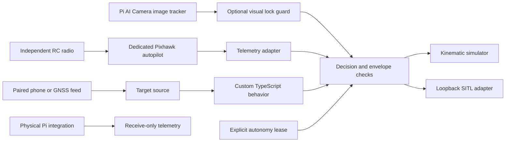

# Architecture and failure behavior

The Pi runs Bun and Stacks for mission/camera logic. During development a dedicated controller runs
ArduCopter or PX4 for
attitude estimation, stabilization, motor timing, independent fencing, battery handling and RC override.
Linux plus JavaScript is not used as a real-time motor-control loop.

The coordinate frame is local north/east/down in metres. The horizontal origin is fixed; altitude
is positive up in user settings and negative down in vectors. The UDP adapter reads local EKF
coordinates, so the target source must use that same EKF origin, not a guessed current GPS position
or an origin that moves with the operator. Home position and EKF origin can differ. Resolve that
reference explicitly in any future physical adapter. GPS altitude from a phone is not copied into
flight altitude; follow altitude is configured above the fixed origin.

## Decisions

| Decision | Simulation | SITL wire behavior |
| --- | --- | --- |
| `velocity` | Apply bounded ideal velocity | Send velocity-only LOCAL_NED setpoint |
| `hold` | Zero ideal velocity | Send zero-velocity setpoints while target validity is lost |
| `release` | Zero ideal velocity | Stop sending; autopilot Guided timeout / failsafes own the response |

`release` does not prove that an aircraft immediately stops, returns home, lands, or becomes manually
controlled. Existing setpoints can persist until the autopilot times them out. Configure and test
that timeout independently. Power loss, Pi failure and SIGKILL cannot deliver a final command.

Checks reject stale/future/non-finite data, unknown batteries, absent position estimates, disarmed or
non-Guided mode, unselected targets, weak/old/inaccurate target fixes, current and predicted envelope
breaches, invalid plugin output, and predicted static-target separation breaches.

These checks provide a software development envelope, not a flight safety certification. They assume
an instantaneous ideal velocity response. Airframe braking, GPS uncertainty, wind, dynamics, terrain,
people and obstacles need separate analysis and independent flight-controller limits.

## Clocks and ownership

All freshness times are local monotonic receipt times from one clock domain. Do not use phone
wall-clock timestamps or vehicle boot times as `receivedAtMs`. Local receipt timestamps do not reveal
a delayed upstream fix: the authenticated source must also reject old/replayed measurements before
calling `update`. Validate freshness at every transport hop.

The controller clones target updates, ignores updates for other target IDs, rejects older updates,
and revokes its lease on backwards local time. Leases are at most five seconds and default to one.
A caller must tick promptly and renew only while the operator's control conditions remain valid.
A blocking plugin can starve that loop, so independent autopilot timeout remains essential.

## Protocol boundary

The codec accepts CRC-valid common messages 0, 1, 32 and 84 in MAVLink v1/v2. It supports v2 zero-tail
reconstruction. Unknown dialects and signed v2 frames are skipped: there is no signature verifier.
The UDP receiver binds loopback only and pins its peer after a matching quadcopter heartbeat for the explicitly selected ArduPilot or PX4 profile.
It uses the oldest heartbeat/position/battery receipt time for freshness. Physical mode deliberately
reports position health false and never transmits. SITL assumes the simulator's position estimator
is healthy; that assumption must never be carried into a physical adapter.

The wire codec is a small experimental subset, not a replacement for a mature full MAVLink stack.
Both external stacks are optional drivers. The [owned-stack ADR](adr/0001-owned-autonomy.md) and
[feature roadmap](roadmap/README.md) define the replacement path. A future physical adapter needs verified estimator status, source identity, sequence/replay handling,
authenticated transport, link supervision, flight-controller configuration and hardware validation.

## Native runtime bench slice

The owned kernel and Pico 2 HAL live in `firmware/runtime/`, with the explicit C++17 exception in
[ADR 2](adr/0002-bench-runtime.md). Stacks owns the [CLI and protocol tools](runtime.md) under
`resources/functions/drone/runtime/`. The first profile is synthetic-sensor and neutral-output
only. It has no physical flight command path and does not replace estimation or vehicle controls.

The optional [sensor bench profile](sensors.md), recorded in [ADR 3](adr/0003-sensor-bench.md),
adds original SPI/I2C/UART acquisition and a receive-only DS stream. TypeScript applies units,
calibration, clock uncertainty and independent health checks. The same pipeline runs against
recordings on the simulator clock. Replay snapshots are diagnostic; estimator fusion is issue #4.

The [owned estimator](estimation.md), recorded in [ADR 4](adr/0004-owned-estimator.md), consumes
qualified sensor events on their capture epochs. It exposes tilt/relative-yaw, GNSS local NED and
separate pressure height with health/reset counters. It is independent of both external autopilots
and remains separate from control telemetry until heading, fusion and hardware validation exist.
